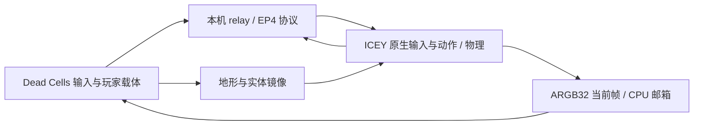

# 架构和源码对应

DC Hero 保留 team、实体身份、相机和关卡引用；自主攻击、玩家物理与受伤结算按载体模式旁路。走跑跳、冲刺、动作机和命中盒在 ICEY 原进程运行，不能在 DC 重写成一套相似动作代替。

`icey/BridgeArena.cs` 隔离原关卡并保留玩家与必需原生管理器；`dc/HostWorld.cs` 与 `icey/WorldMirror.cs` 输出/构造局部碰撞，将原生玩家解算结果回写 DC 载体。单向平台按原生 OneWay 语义处理。

`icey/BridgeKeyboard.cs` 在原生 PCInput 轮询边界提供转发按键；`shared/GateWire.cs` 直接读取 TCP 字节并按行组装，避免 StreamReader 内缓存与 socket Available 不一致造成输入滞留。

`native/ep4_cpu.cpp` 对真实 1024×1024 RenderTexture 做 D3D11 CPU staging 读回。转换/统计在共享锁外完成，仅发布完整帧时持锁；只有最新帧邮箱，没有待显示帧队列。`ep5_hud.cpp` 捕获原生生命/能量，`ep6_dash.cpp` 是独立的冲刺条读回实例。

`dc/CpuDisplay.cs` 上传当前帧并放入世界图层；`NativeResolutionWorld.cs` 保留子对象/延迟队列，将世界绘制放到窗口像素，绘制后 finally 恢复根状态。ICEY 模式暂时隐藏 CamFog；不重复 sync，也不切换雾效 shader 的常量分支。全世界高清绘制仍有额外 GPU 成本。

`GuestCombat / HostCombat / CarrierGuard` 为双向战斗代理；代理带关卡代次与实体 UID。局部命中/防御已有证据，完整能力尚未全部验收。`PlayerMode` 负责 F7、互动和暂停的原生 Hero 暂借；`TestHealing / GuestTestHealing` 负责 F8 的带身份请求与原生回血回执。

`src` 是实际 1.0.3 使用的自研代码，整理仅包含 ICEY csproj 路径参数化与尾空白清理，不改动运行逻辑。`TrapFixture` 与显式探针是开发夹具，默认手测入口不创建它们的触发文件。不要把夹具数据当真实世界/战斗验收。
